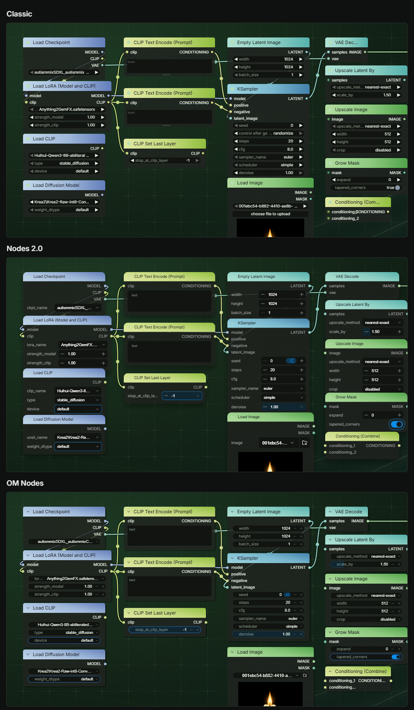

# OM Nodes

ComfyUI's Nodes 2.0, laid out at classic node sizes. Every widget, menu and editor is ComfyUI's
own; Open Manager changes how they are arranged.

Switch it on from **OM Nodes** under **Nodes 2.0** in the ComfyUI menu, or under
**Open Manager → Nodes**. It turns Nodes 2.0 on. Switching it off turns Nodes 2.0 back off if
OM Nodes was what turned it on. Switching Nodes 2.0 off switches OM Nodes off.

## Classic geometry

| | Classic | Nodes 2.0 | OM Nodes |
|---|---|---|---|
| Title bar | 30 | 28 | 30 |
| Slot row | 20 | 20 | 20 |
| List output | a grid of nine squares | a square | a grid of nine squares |
| Widget row | 20, 4 apart | 24, 4 apart | 20, 4 apart |
| Text and file widgets | 20 | 32 | 20 |
| Widget label | inside the widget | its own column | inside the widget |
| A value too long for its widget | the label gives way, then the value is cut | the value is cut | the label gives way, then the value is cut |
| Dragging a number | anywhere on the widget | on its value | anywhere on the widget, label included |
| Narrowest node | the node's own minimum | 225 | the node's own minimum |
| Advanced inputs, Enter subgraph | none | a 44 px tab under the node | an icon in the title bar |
| Node ID and source badges | above the title | a row inside the node | above the title |

A workflow built in classic opens at the same footprint. Nothing overlaps that did not overlap
before, and links meet the same slots.

Title height, slot height, widget height, corner radius and text sizes follow LiteGraph's
values, so a theme that sets them for classic sets them here too.

## Resizing

| | |
|---|---|
| Corners | Width and height |
| Left, right and bottom edges | One dimension, with *Resize nodes from their side and bottom edges* on |
| Several selected nodes | The same change for each, with *Resize every selected node together* on |
| Shift, or snap to grid | Snaps to the grid size |
| Smallest size | The node's classic minimum width, and the height its rows need |
| Text boxes | A grip under each box sets that box's height, with *Drag multiline text boxes to size them* on |

A drag on a slot's dot still starts a link. Each resize is one undo step.

A text box you have sized keeps its height when the node grows; boxes you have not sized share
what is left. When every box on a node is sized, the node grows only from a grip. Double-click a
grip, or use **Reset text box heights** in the node's menu, to give a box back. Heights are saved
in the workflow and are the same in classic nodes.

## Fit to content

**Fit to content** in a node's menu sets the node, or every selected node, to its classic
minimum width and the height its rows need. The `Open Manager: fit selected nodes to content`
command does the same.

A node added while OM Nodes is on fits its rows at once, so hidden advanced inputs leave no
empty space. Nodes loaded from a workflow or pasted keep their saved size.

## Themes

Themes style OM Nodes through `extras.om`: tokens, named parts and scoped CSS. See
[OM Nodes in the theme reference](THEMES.md#om-nodes).

## When ComfyUI changes

OM Nodes checks the node layout when it starts. If ComfyUI has changed it, OM Nodes stands
down: Nodes 2.0 keeps its own look, the switch stays as set, and a notice names the change.
